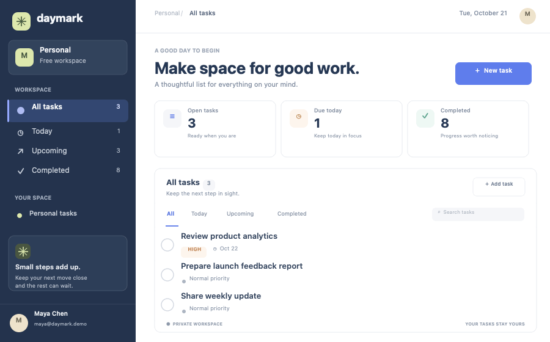

# Daymark

**Make room for what matters.**

Daymark is a small, production-minded task workspace built to demonstrate a complete SaaS flow: email sign-up, protected sessions, password recovery, and private, persistent task management. Each account can only read and change its own tasks.

**Live demo:** [daymark-saas-demo](https://iamzhangjinpeng.github.io/daymark-saas-demo/)

The repository deploys to GitHub Pages on every push to `main`. Connect Supabase using the repository Actions secrets below to enable real sign-in and task storage.

## What you can do

- Create an account with email and password, confirm your email, sign in, and sign out.
- Request a password reset email and set a new password through the secure recovery link.
- Create, edit, complete, reopen, search, filter, and delete tasks.
- Add a description, priority, and optional due date to a task.
- Keep tasks in Supabase Postgres. Data survives refreshes and is isolated with Row Level Security (RLS).
- Visit `/dashboard` while signed out and be redirected to sign in.
- Use the workspace on desktop, tablet, or mobile.

There are no sample accounts, fake task records, or password shortcuts. The app requires a Supabase project before authentication and task storage are enabled.

## Animated product demo



The preview uses sample data to show the task workflow and how each account sees its own workspace.

## Stack

| Area | Technology |
| --- | --- |
| App | Next.js App Router, React, TypeScript |
| Styling | Tailwind CSS 4 and responsive CSS |
| Authentication | Supabase Auth with browser sessions |
| Database | Supabase Postgres with Row Level Security |
| Hosting | GitHub Pages (static export) |
| Icons | Lucide React |

## Run locally

Requires Node.js 20.9 or newer and npm.

1. Install the packages:

   ```bash
   npm install
   ```

2. Create a Supabase project at [supabase.com](https://supabase.com/dashboard).

3. Copy `.env.example` to `.env.local`. Add the project URL and publishable key from **Project Settings → API Keys**:

   ```env
   NEXT_PUBLIC_SUPABASE_URL=https://your-project.supabase.co
   NEXT_PUBLIC_SUPABASE_PUBLISHABLE_KEY=your-supabase-publishable-key
   ```

   Only the publishable key belongs in this app. Never put a secret or service-role key in a `NEXT_PUBLIC_` variable.

4. In the Supabase SQL Editor, run [`supabase/schema.sql`](supabase/schema.sql). This creates the `tasks` table, indexes, timestamp trigger, and per-user RLS policies.

5. In **Authentication → URL Configuration**, set the local Site URL to `http://localhost:3000` and add `http://localhost:3000/auth/confirm/` and `http://localhost:3000/auth/recovery/` to the redirect allow list. For production, add `https://iamzhangjinpeng.github.io/daymark-saas-demo/auth/confirm/` and `https://iamzhangjinpeng.github.io/daymark-saas-demo/auth/recovery/` to the allow list.

6. Start the app:

   ```bash
   npm run dev
   ```

   Open [http://localhost:3000](http://localhost:3000), create an account, and confirm the email if email confirmation is enabled for the Supabase project.

## Deploy to GitHub Pages

GitHub Actions builds the app as a static site and publishes the `out/` directory. In the repository, open **Settings → Secrets and variables → Actions**, then add these repository secrets:

- `NEXT_PUBLIC_SUPABASE_URL`
- `NEXT_PUBLIC_SUPABASE_PUBLISHABLE_KEY`

The GitHub Pages source should be set to **GitHub Actions**. Push to `main` or run the **Deploy to GitHub Pages** workflow manually. In Supabase, add both `https://iamzhangjinpeng.github.io/daymark-saas-demo/auth/confirm/` and `https://iamzhangjinpeng.github.io/daymark-saas-demo/auth/recovery/` to the redirect URL allow list. The Supabase URL and publishable key are public browser configuration; never add a secret or service-role key here.

The app deliberately renders a setup guide while the Supabase variables are missing; it never substitutes local storage or pretend authentication.

## Verify database isolation

The browser smoke test uses a mocked Supabase API. To verify the actual database RLS policies, create and confirm two disposable test accounts in a staging Supabase project, then set `RLS_TEST_SUPABASE_URL`, `RLS_TEST_SUPABASE_PUBLISHABLE_KEY`, `RLS_TEST_USER_A_EMAIL`, `RLS_TEST_USER_A_PASSWORD`, `RLS_TEST_USER_B_EMAIL`, and `RLS_TEST_USER_B_PASSWORD` in your local environment and run:

```bash
npm run verify:rls
```

The script signs in as both test users, creates tagged rows, checks cross-account read/insert/update/delete restrictions, and removes the rows it created. It uses only the publishable key and must only be run against a staging project with disposable accounts; never provide a service-role key or customer account credentials.

## Data security

The browser uses Supabase's publishable key. The `tasks` table requires an authenticated user and has separate select, insert, update, and delete RLS policies tied to `auth.uid()`. The app scopes each request to the signed-in user's ID; RLS verifies that ID against the authenticated session. The database default provides the same ID when an insert omits it. Route checks improve navigation, while RLS remains the data access boundary.

## Project structure

```text
app/
  auth/confirm/page.tsx  Static email confirmation callback
  auth/recovery/page.tsx Password recovery callback
  dashboard/page.tsx     Protected task workspace
  forgot-password/page.tsx Request a password reset email
  login/page.tsx         Email sign-in
  signup/page.tsx        Email registration
components/
  auth-form.tsx          Sign-in and sign-up experience
  dashboard-shell.tsx    Task views and database-backed CRUD
  password-recovery.tsx  Password reset request and update
  setup-state.tsx        Supabase connection instructions
lib/supabase/            Browser Supabase client and configuration
supabase/schema.sql      Tasks table and user-scoped RLS
```

## Static production build

```bash
npm run build
```

The exported site is written to `out/`.

## Automated smoke checks

Run `npm run test:e2e` to check sign-in, switching between two isolated task lists, task creation, and the sign-in layout at tablet and phone widths. The test uses a mocked Supabase API and does not access or modify your Supabase project; the database RLS policies remain the production security boundary.
